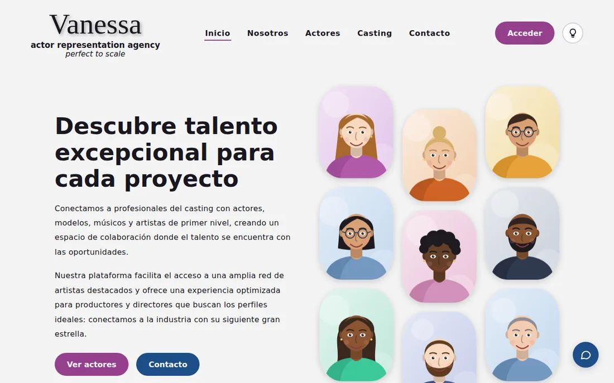
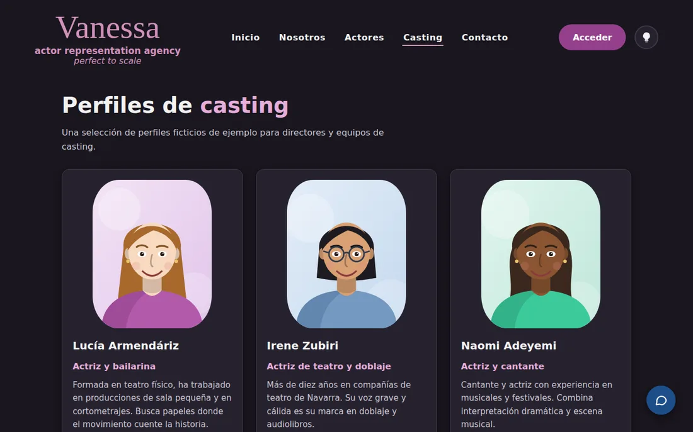
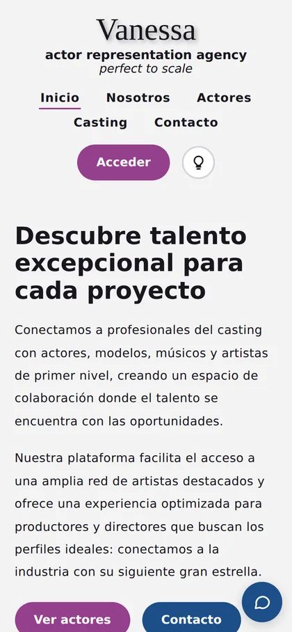

# Vanessa · web de una agencia de representación de actores

> **English summary:** a static, accessible and responsive website for a fictional actor-representation agency, rebuilt from my HTML & CSS course final project. Plain HTML, CSS and a little JavaScript, no dependencies, 88 KB in total, zero accessibility violations (axe-core, WCAG 2.1 AA) in 9 pages and 2 themes. All the profiles and the illustrations are fictional and original.

**Demo:** https://renaabbasova.github.io/Actor_Agency_Website/



| Casting en modo oscuro | Móvil |
|---|---|
|  |  |

## De dónde sale

Es el proyecto final del módulo de HTML y CSS de **Albañiles Digitales – Software Builders**. La idea surgió de una amiga que tiene un negocio de representación de actores y quería un sitio donde centralizar los perfiles de cada actor. El logo, la paleta, el diseño de la galería y los textos son los del proyecto original; esta versión corrige lo que tenía mal y lo hace funcionar de verdad.

## Páginas

| Página | Qué hace |
|---|---|
| `index.html` | Portada con la galería flotante de perfiles |
| `about.html` | Sobre la agencia |
| `actores.html` | Galería de los 17 perfiles, cada uno enlaza a su ficha |
| `casting.html` | Tarjetas de casting con enlace a la ficha |
| `profile.html?id=…` | Ficha de un actor: edad, altura, idiomas, habilidades |
| `contact.html` | Formulario de contacto y mapa |
| `login.html`, `forgot-password.html` | Formularios de acceso y de recuperación (de demostración) |

Todo funciona sin servidor: los perfiles viven en `js/actors.js` y se dibujan con JavaScript sin `innerHTML`. Los formularios validan en el navegador y muestran un aviso de demostración; **no envían nada**.

## Qué corregí respecto a la versión del curso

Todo lo de la columna "antes" lo medí en el proyecto original.

| | Antes | Ahora |
|---|---|---|
| **Peso** | 27 MB: la carpeta, una copia anidada y un `.zip` de 9,5 MB; imágenes PNG de hasta 1,7 MB. La portada cargaba unos 860 KB locales | **88 KB** en total; la portada carga unos 40 KB |
| **Fotos** | Retratos de personas reales | 17 **avatares ilustrados originales** en SVG (2 KB cada uno) y nombres ficticios |
| **Idioma** | `lang="en"` en una web en español, y textos mezclados en inglés y español | `lang="es"` y todo el contenido en español (los textos de marca, en inglés, marcados con `lang="en"`) |
| **Estructura** | 4 de 7 páginas sin `h1`; solo 1 con `<main>`; la de contacto, sin menú | Todas con cabecera, menú, `main`, pie y enlace para saltar al contenido |
| **Imágenes** | 28 sin texto alternativo | Todas con texto alternativo |
| **Formularios** | 10 campos sin etiqueta; el botón de enviar era un enlace a `#`; "Register" apuntaba a la propia página de login | Campos con etiqueta, formularios reales con validación nativa |
| **Móvil** | 3 páginas se salían de pantalla (la portada llegaba a 509 px con una pantalla de 390) | Sin desbordes de 320 a 1440 px |
| **JavaScript** | 4 de 7 páginas lanzaban un error (`Cannot read properties of null`), la de login incluida | Sin errores; el tema claro/oscuro respeta la preferencia del sistema y se recuerda |
| **Casting** | HTML corrupto (un trozo de CSS pegado dentro de un atributo), 10 tarjetas con el mismo nombre y texto de relleno, y 15 enlaces `#` que no hacían nada | Fichas de perfil que funcionan, con datos distintos |
| **Fuente** | La URL de Google Fonts estaba mal escrita y Roboto nunca se cargaba | Fuentes del sistema; iconos en SVG; sin librerías externas |
| **Movimiento** | Animaciones infinitas siempre | Se desactivan con `prefers-reduced-motion` |
| **Contacto** | Botón de WhatsApp con un número falso (555) y un mapa con parámetros sin rellenar | Botón de contacto a la página de contacto y mapa de OpenStreetMap |

También quité del texto de la portada una frase de relleno heredada ("Desde el siglo XVI, el mundo de la impresión y la tipografía…") que no tenía que ver con la agencia, y oscurecí un poco los colores de los botones para que el texto blanco cumpla el contraste mínimo.

## Cómo lo comprobé

- **Accesibilidad:** [axe-core](https://github.com/dequelabs/axe-core) con las reglas WCAG 2.0/2.1 A y AA y las buenas prácticas, en las 9 páginas y en los dos temas: **0 infracciones**.
- **Responsive:** sin desbordes horizontales a 320, 390, 768, 1024 y 1440 px.
- **Funcionamiento:** 21 pruebas con un navegador automatizado (tema, galerías, fichas, formularios con datos válidos e inválidos, teclado, movimiento reducido) y ningún error en la consola.

## Limitaciones

- Es una **demostración**: los perfiles y las ilustraciones son ficticios, y los formularios no envían nada ni hay sesión.
- La única dependencia externa es el mapa de OpenStreetMap de la página de contacto.
- Hay una comprobación automática de accesibilidad, pero no sustituye a una prueba con personas que usen lector de pantalla.

## Verlo en local

Abre `index.html` en el navegador, o sirve la carpeta:

```bash
python3 -m http.server 8000   # y abre http://localhost:8000
```
